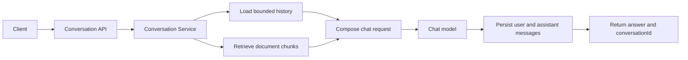

# Conversation & Memory Implementation Plan

## Status

Conversation history is implemented: `/api/chat` accepts an optional `conversationId`, persists user and assistant turns in PostgreSQL, loads a configured recent-message window for follow-up questions, and returns the conversation ID. Conversation history is separate from document chunks in PGVector.

Human-reviewed memory proposals are implemented in a first, conversation-scoped form. Users can propose a memory from an assistant reply, inspect its source passage, edit the pending proposal, and explicitly approve or reject it. Approved memories can be revoked or deleted. Only approved memories for the current conversation are supplied to later prompts. Automatic extraction and cross-conversation, person-scoped memory are not implemented.

## Scope and terminology

Use two separate forms of memory:

- **Conversation history (short-term memory):** recent user and assistant messages associated with one conversation. It helps resolve follow-up references such as “What about the next maintenance step?”
- **Document knowledge (RAG corpus):** source documents and their chunks in the vector store. It supplies factual evidence and remains the authority for technical answers.

Do not automatically promote chat messages into the vector store. Conversation history may contain incorrect assumptions, sensitive data, or transient requests. Durable user preferences or facts should be a separate, explicit feature with consent, ownership, review, and deletion controls.

## Human-in-the-loop requirement

Any feature that turns conversation content into durable, reusable memory must require an explicit human decision before the memory can affect later answers:

1. Present each proposed memory to the user with enough context to understand where it came from.
2. Let the user edit, approve, or reject the proposal. Do not store or use a proposal as durable memory before approval.
3. Make approved memories visible and let the user revoke or delete them later.
4. Keep approved memories scoped to their owner and separate from both raw conversation history and the source-document corpus.
5. Do not interpret ordinary conversation persistence as consent to create durable memory.

The current implementation lets a user manually propose a memory from an assistant reply; there is no automatic extraction. It implements the pending, approved, rejected, and revoked states and sends only approved memories from the active conversation to the model. It does not require a human to approve every generated answer or every document ingestion. If either workflow is intended, specify it separately.

## Functional requirements

1. A client can create a conversation and receive a stable `conversationId`.
2. A client can submit multiple turns to the same conversation.
3. Each turn uses a bounded recent message window to understand follow-ups.
4. Each answer continues to use relevant document retrieval and the existing metadata filters (`docId`, `section`, `equipment`, `revision`, `effectiveDate`).
5. Conversation history is persisted so the conversation survives an application restart.
6. Conversations are isolated by owner. If authentication is not yet available, treat the generated conversation ID as an opaque capability and do not expose history lookup by ID without access controls in a shared deployment.
7. Clients can retrieve conversation history and clear or delete a conversation, subject to ownership checks.
8. The API returns the conversation ID with each answer.
9. History size and retention are bounded by configuration; old messages are not sent to the model indefinitely.
10. Conversation memory is not treated as verified source evidence. Factual responses remain grounded in retrieved documents.

## Proposed API

### Create conversation

`POST /api/conversations`

Response:

```json
{
  "conversationId": "opaque-generated-id",
  "createdAt": "2026-10-08T12:00:00Z"
}
```

### Send a turn

`POST /api/chat`

Request:

```json
{
  "conversationId": "opaque-generated-id",
  "question": "What is the next maintenance step?",
  "equipment": "Pump-07",
  "revision": "Rev-3"
}
```

Response:

```json
{
  "conversationId": "opaque-generated-id",
  "answer": "...",
  "sources": []
}
```

For compatibility, decide whether `conversationId` may be omitted to create a one-turn conversation or is required after a transition period. Prefer explicit conversation creation for clients that need predictable lifecycle behavior.

### Read and delete conversation

- `GET /api/conversations/{conversationId}` returns the caller's conversation messages and timestamps.
- `DELETE /api/conversations/{conversationId}` deletes the conversation and its messages.
- Optionally provide a clear-history operation that retains the conversation ID while removing its messages.

Do not add these endpoints until a reliable ownership check is available for multi-user deployments.

## Architecture



### Application responsibilities

- **Controller:** validate the request and return response DTOs; do not implement memory behavior.
- **Conversation service:** create/load/clear/delete conversations and enforce ownership rules.
- **RAG orchestration service:** combine bounded history, document retrieval, filters, and model invocation.
- **Conversation repository:** persist conversation metadata and messages.
- **Document vector store:** continue to hold source-document chunks only.

## Persistence design

Use the existing PostgreSQL database for conversation records. Keep conversation persistence logically separate from PGVector document chunks.

Suggested relational schema:

### `conversation`
- `id` (primary key; UUID or equivalent opaque ID)
- `owner_id` (nullable only for explicitly single-user/local mode)
- `created_at`
- `updated_at`
- `expires_at` (optional retention deadline)

### `conversation_message`
- `id` (primary key)
- `conversation_id` (foreign key with cascade delete)
- `role` (`USER` or `ASSISTANT`; system prompts are configuration, not user history)
- `content`
- `created_at`
- optional token count and request correlation ID for diagnostics

Index messages by `(conversation_id, created_at)`. Define a retention policy and migration strategy before deploying persistent history.

Spring AI provides chat-memory abstractions and repository implementations. Before selecting a JDBC repository or advisor class, verify that its artifact and API match this repository's Spring AI version. Encapsulate it behind the application's conversation service so persistence implementation can change without affecting the API.

## Request processing sequence

1. Validate the conversation ID and question; enforce input length limits.
2. Load the conversation and verify its owner/access policy.
3. Load only the configured recent message window. Never load all history by default.
4. Perform document similarity search using the question and requested metadata filters.
5. Compose the model request from the bounded history, current question, and retrieved document context.
6. Instruct the model to use retrieved documents as factual evidence; conversation history may clarify references but must not override conflicting source documents.
7. Invoke the model.
8. Persist the user turn and successful assistant answer atomically where practical. Avoid persisting an assistant answer when generation failed.
9. Return the answer, conversation ID, and source references if citation support is enabled.

Do not rely on advisor ordering by assumption. Verify the actual Spring AI advisor chain and test that the model receives both the intended history and retrieved context. If an advisor-based composition cannot guarantee this, compose the prompt explicitly in the application service.

## Memory policy

- Start with a configurable sliding window, for example the most recent 10 messages or a token budget; choose based on the model context window and retrieval context size.
- Keep system instructions out of persisted user conversation history.
- Do not place access tokens, credentials, or other secrets into prompts or stored memory.
- Define whether user messages and assistant messages are retained, and for how long.
- Log conversation IDs and processing outcomes, not full message bodies by default.
- Support deletion and ensure it removes both the conversation row and associated messages.
- For long conversations, summarize older turns only as a later optimization. A generated summary is untrusted context, must be attributable to its source turns, and must not replace document retrieval.
- Do not create a global memory shared across users.

## Original implementation phases

### Phase 1: Conversation contract
- Add conversation request/response DTOs and a conversation creation endpoint.
- Add `conversationId` to chat requests and responses.
- Keep existing metadata filters intact.
- Decide behavior for requests without a conversation ID.

### Phase 2: Persistence and ownership
- Add schema migration for conversations and messages.
- Implement repository operations for create, load recent messages, append, clear, and delete.
- Establish authenticated owner scoping before enabling cross-user history access.
- Add retention configuration and cleanup policy.

### Phase 3: RAG and memory composition
- Load bounded history for each turn.
- Keep document retrieval in the same request flow and preserve current metadata filtering.
- Compose prompts so history resolves conversational references while retrieved source documents provide factual grounding.
- Persist user and assistant turns after appropriate validation and generation.

### Phase 4: Lifecycle and operational controls
- Implement history retrieval, clear, and delete endpoints with access checks.
- Add retention cleanup and metrics for message count, generation latency, and failures.
- Ensure logs do not expose sensitive message bodies.

### Phase 5: Quality validation
- Test a multi-turn follow-up that depends on a prior turn.
- Test that conversations do not leak messages to one another.
- Test restart persistence, clear/delete behavior, retention, and invalid IDs.
- Test that metadata filters still constrain document retrieval.
- Test that unsupported answers remain ungrounded rather than being invented from chat history.

## Acceptance criteria

- A client can create a conversation, ask multiple questions, and receive the same conversation ID throughout.
- A follow-up question can use recent conversation context.
- Answers continue to retrieve and use document chunks under the supplied metadata filters.
- Conversation history is bounded and survives application restart.
- One conversation cannot read another conversation's messages.
- Clear/delete and retention behavior are tested and documented.
- Conversation messages are not silently written into the document vector store.
- Existing one-turn chat behavior is either preserved compatibly or intentionally migrated with API documentation.

## Risks and mitigations

### History can override source evidence
Keep document context authoritative for technical claims and test conflicts between history and retrieved documents.

### Conversation IDs can become an access-control weakness
Treat IDs as opaque identifiers, enforce owner checks, and avoid history endpoints without authentication or equivalent authorization.

### Long histories increase latency and cost
Use a configurable message/token budget and measure the prompt size.

### Sensitive data may be retained
Set explicit retention, support deletion, minimize logs, and define data handling before production use.

### Spring AI APIs vary by release
Verify implementation classes and advisor behavior against the pinned Spring AI dependencies before coding; isolate them behind service/repository interfaces.

## Current implementation status

Implemented in the application:

- Conversation creation, optional conversation IDs on chat requests, and conversation IDs in chat responses.
- Persistent user/assistant messages, bounded recent history, and history retrieval.
- Conversation deletion and scheduled retention cleanup.
- RAG prompts that use history for conversational context while keeping retrieved documents authoritative for factual claims.
- Human-reviewed conversation memory proposals with edit-before-approval, approve/reject, revoke, and delete controls.
- Only approved memory content is included in subsequent prompts for the same conversation; pending/rejected/revoked items are excluded.

Still missing or limited:

- No authentication or owner scoping. UUIDs are opaque identifiers, not authorization; the README limits this to local/single-user use.
- Memory is conversation-scoped, not person-scoped, and is not shared across conversations.
- No automated memory extraction, clear-history endpoint, or citation payload.
- Existing conversation turns are saved automatically as short-term history, but are never silently promoted to approved memory.

Before multi-user deployment, add authenticated owner scoping to conversation and memory endpoints. Do not treat an unguessable conversation ID as authorization.
