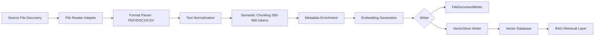

# Ingestion Pipeline Implementation Plan

## Objective

Build a document ingestion pipeline that reliably ingests source documents from network shares and cloud storage, transforms them into semantic chunks with provenance metadata, embeds them, and stores them in a vector database for downstream RAG retrieval.

This plan aligns with the Spring AI + PGVector architecture already used in the project, while supporting enterprise ETL requirements for incremental updates and operational traceability.

---

## Functional Requirements

### 1. Document Ingestion (ETL)

The system shall read documents from network shares and cloud storage in the following formats:

- PDF
- DOCX
- CSV

It shall ingest these files and convert them into structured, vector-ready text content.

### 2. Semantic Chunking

The system shall split document content into semantic chunks with target size in the range of 300–800 tokens.

Each chunk shall include source metadata:

- docId
- section
- equipment
- revision
- effectiveDate

### 3. Embedding and Persistence

The system shall generate embeddings for each chunk and store them with metadata in a vector database.

Supported storage targets include:

- MariaDB / PGVector
- Milvus

The system shall preserve both content and metadata so retrieval can filter by document lineage and deployment context.

### 4. Incremental Ingestion

The system shall support scheduled and on-demand ingestion jobs.

Incremental updates shall be based on:

- checksum
- lastModified

This ensures unchanged files are skipped and modified files are reprocessed without full re-indexing.

### 5. Writer Abstractions

The system shall support:

- FileDocumentWriter for debug dumps and local inspection
- VectorStore writer for persistence into the vector database

This supports both development debugging and production-scale storage.

---

## Ingestion Processing Flow



---

## Proposed Architecture

### 1. Source Connectors

Implement source adapters for:

- Network shares (SMB/NFS/UNC paths)
- Cloud storage sources (Azure Blob, S3, GCS, etc.)

Each connector shall expose:

- listFiles()
- readFile()
- getLastModified()
- getChecksum()

### 2. Document Readers

Readers shall normalize each file type into plain text:

- PDFReader
- DocxReader
- CsvReader

Normalization responsibilities:

- strip garbage characters
- preserve section boundaries and tables where possible
- capture document metadata from file properties and headers

### 3. Chunking Service

Use a token-aware semantic chunking strategy with a target range of 300–800 tokens.

Recommended configuration:

- chunkSize: 500
- overlap: 80-120
- preserve section boundaries where possible

Each chunk object should include:

- id
- docId
- section
- equipment
- revision
- effectiveDate
- content
- chunkIndex
- checksum

### 4. Embedding Layer

The system shall generate embedding vectors per chunk using the configured Ollama or compatible embedding model.

Recommended pipeline:

- chunk → embedding model → vector → store

This should use the same embedding strategy during both ingestion and query-time retrieval for consistency.

### 5. Metadata Model

Maintain a metadata envelope for every chunk:

```json
{
  "docId": "DOC-1024",
  "section": "Maintenance Manual",
  "equipment": "Pump-07",
  "revision": "Rev-3",
  "effectiveDate": "2026-10-01",
  "sourcePath": "\\\\fileserver\\engineering\\manuals\\pump-07.pdf",
  "lastModified": "2026-10-07T15:00:00Z",
  "checksum": "sha256:...",
  "chunkIndex": 12
}
```

### 6. Persistence Layer

The vector store writer shall persist:

- chunk text
- embedding vector
- metadata map
- document lineage information

Implement support for:

- PGVector via Spring AI `VectorStore`
- Milvus via native connector if required
- MariaDB with vector extension if that environment is chosen

### 7. Incremental Update Strategy

The ingestion service shall perform a file-state comparison before re-indexing.

Decision logic:

- if checksum is unchanged and lastModified is unchanged → skip
- if checksum differs or lastModified is newer → reprocess and upsert
- if file deleted → remove stale vector entries or mark them inactive

This supports both:

- scheduled jobs (nightly or periodic sync)
- on-demand jobs (manual re-index or refresh)

### 8. Debug and Production Writers

Implement writer interfaces that support dual output:

- `FileDocumentWriter`

  - dumps chunk text and metadata to local debug files
  - useful for QA and diagnostics
- `VectorStoreWriter`

  - persists embeddings and metadata to vector DB
  - used in production/RAG environment

This allows developers to validate chunk quality before final persistence.

---

## Job Types

### Scheduled Ingestion Jobs

Use a scheduler such as Spring Scheduler or Quartz to do periodic ingestion.

Typical cadence:

- hourly
- daily
- nightly full refresh depending on data change volume

### On-Demand Jobs

Support manual triggers through:

- REST API endpoint
- admin console action
- CLI runner

Example actions:

- ingest one file
- ingest one directory
- refresh changed files only
- force full reindex

---

## Data Flow Example

1. File discovery scans configured network share or cloud storage path.
2. File metadata is captured: path, size, checksum, lastModified.
3. File is parsed to text based on file type.
4. Text is normalized and split into token chunks.
5. Source metadata is attached to each chunk.
6. Each chunk is embedded and written to the vector store.
7. FileDocumentWriter saves a debug dump for inspection.
8. The scheduler or API marks the ingestion result as success, skipped, updated, or failed.

---

## Implementation Steps

### Phase 1: Foundation

- Define data model for documents and chunks
- Define writer interfaces and ingestion result model
- Implement source metadata capture

### Phase 2: File Processing

- Add PDF, DOCX, and CSV readers
- Add text normalization and chunking strategy
- Validate range of chunk size (300–800 tokens)

### Phase 3: Embedding and Storage

- Add embedding generation step
- Integrate with PGVector or Milvus
- Add a debug writer for file-based dumps

### Phase 4: Incremental Update Logic

- Add checksum and lastModified comparison
- Support scheduled and on-demand trigger paths
- Add stale record handling and upsert logic

### Phase 5: Operations and Validation

- Add ingest job logs and metrics
- Add retry and failure handling
- Add tests for PDF, DOCX, CSV, and incremental updates

---

## Recommended Service Interfaces

```java
public interface DocumentIngestionService {
    IngestionResult ingestFile(Path sourcePath);
    IngestionResult ingestDirectory(Path directory);
    IngestionResult ingestFromSource(SourceDescriptor source);
    IngestionResult refreshChangedFiles();
}
```

```java
public interface FileDocumentWriter {
    void write(DocumentChunk chunk, String outputPath);
}
```

```java
public interface VectorStoreWriter {
    void save(List<DocumentChunk> chunks);
    void upsert(List<DocumentChunk> chunks);
}
```

---

## Acceptance Criteria

The implementation is complete when:

- PDFs, DOCX files, and CSV files can be read from both network shares and cloud storage.
- Inputs are converted into semantic chunks sized between 300 and 800 tokens.
- Each chunk has docId, section, equipment, revision, and effectiveDate metadata.
- Embeddings are persisted in a vector database with metadata.
- Incremental updates based on checksum and lastModified are supported.
- Scheduled and on-demand ingestion jobs both work correctly.
- FileDocumentWriter produces debug dumps for verification.
- VectorStore writer persists production data.

---

## Risks and Mitigations

### Risk: Multi-format parsing quality varies

Mitigation: Use dedicated readers and validate extracted content against source structure.

### Risk: Chunk boundaries reduce retrieval quality

Mitigation: Tune chunk size and overlap. Validate with sample corpora and retrieval tests.

### Risk: Re-ingestion creates duplicate vectors

Mitigation: Maintain checksum and upsert semantics.

### Risk: Cloud or share connectivity failure

Mitigation: Add retry logic and job-level observability.

---

## Recommended Next Steps

1. Create source detection and file enumeration adapters.
2. Implement reader adapters for PDF, DOCX, and CSV.
3. Add chunking service with metadata enrichment.
4. Add embedding + vector store persistence with writer abstraction.
5. Implement checksum/lastModified incremental sync logic.
6. Add scheduler and manual trigger endpoints.
7. Validate with debugging dumps and retrieval E2E tests.

---

## Summary

The ingestion pipeline should be implemented as a robust ETL system with multi-source readers, semantic chunking, metadata-aware embedding, vector persistence, and incremental update logic. By separating file-based debug output from production vector persistence, the architecture stays operationally transparent and easy to validate during development, while remaining scalable for production RAG workloads.
