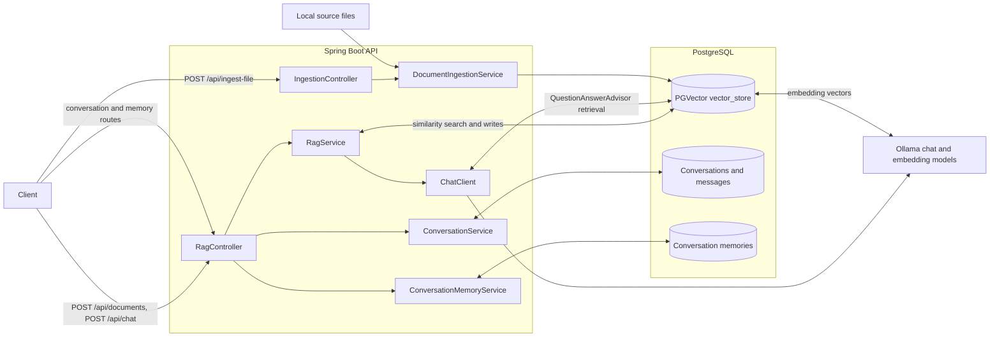
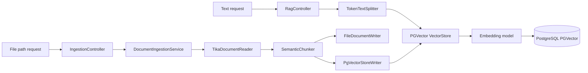
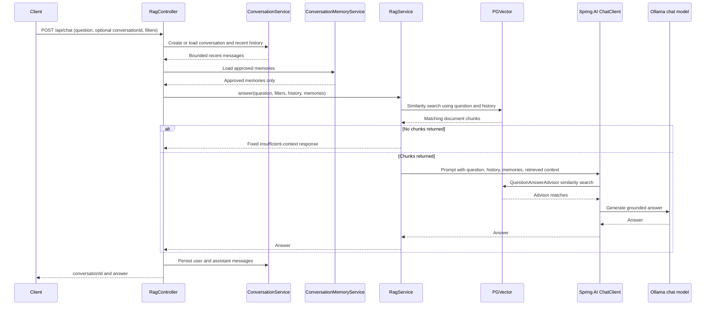
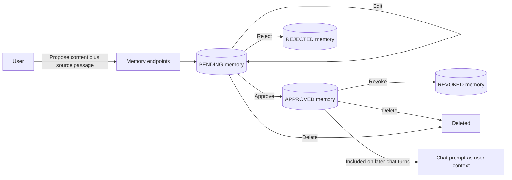

# RAG with Spring AI — Demo Guide

## Presentation goal

Show how this application turns source documents into searchable evidence, retrieves relevant passages for a question, and uses Spring AI with Ollama to generate a grounded answer. Also show how conversational history and user-approved memories are handled separately from the document corpus.

## Suggested talk track

1. **The problem:** A chat model does not automatically know the contents of our private project notes. RAG lets us retrieve relevant text from our own corpus at question time.
2. **Ingestion:** We parse or accept text, split it into chunks, generate embeddings, and store each chunk with metadata in PostgreSQL/PGVector.
3. **A question:** We load bounded conversation history and approved memories, search the vector store, and send the question and retrieved context to the chat model.
4. **The advisor concept:** Spring AI advisors can add behavior around a `ChatClient` call, including vector search and context augmentation.
5. **Memory boundaries:** Recent chat history, approved user preferences, and factual source documents are three different things with different purposes.
6. **Limitations:** The current implementation has two ingestion paths and both explicit retrieval and a configured advisor. Explain this accurately and call out the opportunity to consolidate retrieval.

## RAG in one minute

**Retrieval-augmented generation** combines two steps:

- **Retrieval:** find document chunks that are semantically similar to a question.
- **Generation:** give those passages to a language model as context, then ask it to answer.

An embedding model represents text as a vector of numbers. Similar meanings tend to have nearby vectors, even when the wording is different. PGVector stores the vectors alongside the chunk text and metadata, and performs similarity search when a question arrives.

The vector store does not itself write the final answer. It finds candidate evidence; the chat model generates the response. The answer quality depends on the source content, chunking, embeddings, retrieval settings, prompt, and model.

## Architecture at a glance



The diagram is conceptual: the embedding integration is supplied to Spring AI's vector-store implementation, which creates embeddings as documents are added and queries are searched. Conversation tables and vector documents are logically separate even though they use the same PostgreSQL database.

## Document ingestion

There are two ways to add documents:

### Text submitted through `POST /api/documents`

`RagController` passes the text and source label to `RagService`. The service makes a Spring AI `Document`, splits it with `TokenTextSplitter` (configured with an 800-token chunk size), and adds the chunks to the vector store.

### A local file submitted through `POST /api/ingest-file`

`IngestionController` accepts a server-side file path and metadata. `DocumentIngestionService` checks that the file exists, reads it with Apache Tika, creates overlapping chunks, and sends them to both a file/debug writer and the PGVector writer. The current chunker targets 500 words with 100 words of overlap and attaches `docId`, `section`, `equipment`, `revision`, `effectiveDate`, `sourcePath`, `chunkIndex`, and a checksum.



**Important distinction:** the file-ingestion checksum index is currently in process memory. It is not durable across application restarts. The file endpoint expects a path the server can read; it is not a browser file-upload endpoint.

## What happens during chat

`POST /api/chat` can receive a question, an optional `conversationId`, and optional document metadata filters.

1. `RagController` creates a conversation if no ID was supplied, or loads the existing conversation.
2. It loads the configured recent message window (10 messages by default), builds a document filter, and loads only approved memories for that conversation.
3. `RagService` builds a retrieval query from the current question plus prior user questions, searches PGVector, and applies any requested metadata filters to the returned matches.
4. If the search returned no context, `RagService` returns a fixed “not enough relevant context” response without calling the chat model.
5. Otherwise, it creates a prompt containing the conversation history, current question, approved memories, and retrieved source context. The system instruction says that factual answers must be supported by retrieved context.
6. Spring AI invokes the configured `ChatClient`, which calls the Ollama chat model.
7. `ConversationService` stores the user question and assistant answer, and the API returns the answer with the conversation ID.



## Spring AI advisors

An advisor is a Spring AI extension point around a `ChatClient` call. Advisors can inspect or transform a request, perform retrieval, add context, and participate in response processing. `QuestionAnswerAdvisor` is Spring AI's vector-store advisor for retrieving relevant documents and adding them to a chat request.

`RagConfiguration` attaches a `QuestionAnswerAdvisor` to the default `ChatClient`, configured for `topK = 5` and a similarity threshold of `0.55`. It also sets a default system instruction.

**Current implementation nuance:** `RagService` already performs its own vector search before it calls that `ChatClient`, with a similarity threshold of `0.0` and `topK` 5 (or 10 when filters are requested). The advisor is also attached to the client call. As a result, a normal answer request has a manual retrieval step and a configured advisor retrieval step. The advisor uses its own settings and does not receive the metadata filter that `RagService` applied to its search. This differs from the simpler advisor-only pipeline described in `ADVISORS_PIPELINE_COMPOSITION.md`.

For a clean production pipeline, choose one retrieval owner:

- **Advisor-driven:** pass the question and appropriate advisor parameters, and configure metadata filtering in the advisor search request.
- **Service-driven:** keep retrieval, filters, and empty-result handling in `RagService`, and remove the vector-store advisor from this `ChatClient`.

Consolidating this behavior would make retrieval settings and filtering easier to reason about. Until then, present the service's explicit search as the first retrieval step and the configured advisor as an additional layer—not as the only retrieval mechanism.

## Three kinds of context

| Context                | Stored in                            | How it is used                                                                        | Is it factual source evidence?               |
| ---------------------- | ------------------------------------ | ------------------------------------------------------------------------------------- | -------------------------------------------- |
| Document knowledge     | PGVector `vector_store`            | Similarity search finds relevant source chunks                                        | Yes; this is the intended factual grounding  |
| Conversation history   | PostgreSQL conversation tables       | A bounded recent window helps resolve follow-up questions                             | No; used for conversational context          |
| Approved user memories | PostgreSQL `conversation_memories` | User-approved preferences/context are included in later prompts for that conversation | No; explicitly excluded as verified evidence |

Memory proposals start as `PENDING`. The user may edit a pending proposal, approve or reject it, revoke an approved memory, or delete it. Only `APPROVED` memory content is passed to the chat prompt. The app does not automatically turn chat messages into durable memories.



Conversation history is stored automatically and is separate from these reviewed memories. Deleting a conversation cascades to its messages and associated memories; clearing the vector store does not remove conversation data.

## Live demo script

Start the dependencies and app from the `Capstone` directory:

```powershell
docker compose up -d
mvn spring-boot:run
```

Make sure Ollama is running and has the configured `llama3.2` and `nomic-embed-text` models available. Then ingest a small, distinctive note:

```powershell
$document = @{
    source = "demo-notes"
    content = "In this demo, RAG retrieves relevant document chunks before generation. PGVector stores embeddings so semantically similar passages can be found for a question."
} | ConvertTo-Json

Invoke-RestMethod -Method Post -Uri http://localhost:8080/api/documents `
    -ContentType "application/json" -Body $document
```

Ask a question that paraphrases the note:

```powershell
$question = @{ question = "How does this demo find relevant passages?" } | ConvertTo-Json
Invoke-RestMethod -Method Post -Uri http://localhost:8080/api/chat `
    -ContentType "application/json" -Body $question
```

Use the returned `conversationId` on a follow-up question to demonstrate history. To show persistence, restart the application without removing the Postgres volume and ask again. The vector data persists in PostgreSQL; the application does not automatically ingest the README or local notes on startup.

The reset endpoint removes **all** rows in the vector store and is destructive:

```powershell
Invoke-RestMethod -Method Delete -Uri http://localhost:8080/api/vector-store
```

It does not delete conversations, memories, or source files. Re-ingest the demo note after resetting if you want to continue the demo.

## Presenter notes: limitations and next steps

- Retrieval success is not the same as answer quality. A search can return passages that are only weakly relevant; evaluate chunking, search thresholds, filters, and prompts together.
- The manual service search currently uses a `0.0` similarity threshold; the advisor has a separate `0.55` threshold. The advisor and service can therefore behave differently.
- Chat responses currently return the answer and conversation ID, not citations or source-chunk identifiers.
- The API has no authentication. Keep it local/trusted; conversation IDs are not an authorization system.
- File-path ingestion reads files available to the server. Do not expose that endpoint to untrusted callers.
- The vector-store reset route is destructive and currently unauthenticated; protect the service before deploying it to a shared environment.
- Useful next steps include consolidating retrieval, exposing source citations, testing retrieval quality with known questions, and adding authentication/authorization before multi-user use.

## Source references

- `RagController` and `RagService`: chat, text ingestion, prompt construction, and explicit retrieval.
- `RagConfiguration`: `ChatClient`, default prompt instruction, and advisor setup.
- `IngestionController` and `DocumentIngestionService`: file-ingestion path.
- `ConversationService` and `JdbcConversationRepository`: bounded history and persistence.
- `ConversationMemoryService` and `JdbcConversationMemoryRepository`: reviewed, conversation-scoped memories.
- `ADVISORS_PIPELINE_COMPOSITION.md`: advisor design notes; compare with the current dual-retrieval behavior described above.
- `INGESTION_PIPELINE_PLAN.md`: ingestion design notes; distinguish proposed plans from the implementation details in this guide.
